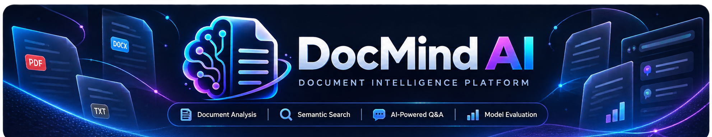
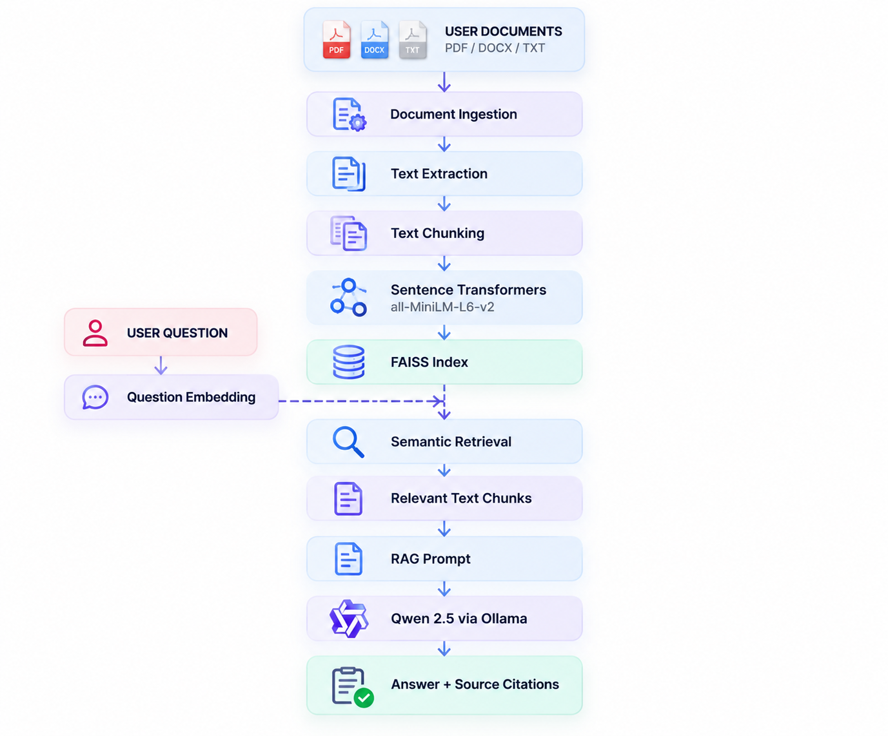

<p align="center">
  
</p>

<h1 align="center">DocMind AI</h1>

<p align="center">
  <strong>Intelligent Document Analysis powered by Retrieval-Augmented Generation</strong>
</p>

<p align="center">
  
  
  
  
  
</p>

---

## Overview

**DocMind AI** is a document intelligence platform that enables users to upload documents, explore their contents, perform semantic searches, and ask questions using a locally running large language model.

The application implements a Retrieval-Augmented Generation (RAG) architecture that combines semantic embeddings, FAISS vector search, and Qwen 2.5 to generate context-aware answers supported by document citations.

The project also includes evaluation tools for analyzing retrieval performance and assessing generated-answer quality.

## Key Features

- **Document Processing:** Upload and process PDF, DOCX, and TXT documents.
- **Document Intelligence:** Extract text and divide documents into searchable chunks.
- **Semantic Search:** Retrieve relevant passages using vector similarity.
- **AI Question Answering:** Generate answers using retrieved document context.
- **Source Citations:** Display references to the documents used in responses.
- **Local LLM:** Run Qwen 2.5 through Ollama.
- **Persistent Sessions:** Save and restore indexed documents.
- **Retrieval Evaluation:** Measure Precision@K, Recall@K, MRR, and retrieval latency.
- **Answer Evaluation:** Inspect citation validity, citation coverage, and expected answer behavior.
- **LLM-as-a-Judge:** Evaluate answer groundedness and relevance.
- **Interactive Dashboard:** Explore document statistics, retrieval results, and evaluation charts.

## Technology Stack

| Component | Technology |
|---|---|
| Programming Language | Python 3.12 |
| User Interface | Streamlit |
| Embedding Model | all-MiniLM-L6-v2 |
| Vector Database | FAISS |
| Language Model | Qwen 2.5 3B |
| Local Model Runtime | Ollama |
| Data Processing | NumPy, Pandas |
| Visualization | Plotly |
| Document Formats | PDF, DOCX, TXT |

## RAG Architecture

<p align="center">
  
</p>

## Project Structure

```text
DocMind-AI/
|
|-- app.py
|-- README.md
|-- requirements.txt
|
|-- assets/
|   |-- docmind_logo_transparent.png
|   |-- docmind_icon.png
|   `-- docmind_github_banner.png
|
|-- src/
|   |-- dashboard/
|   |-- embeddings/
|   |-- evaluation/
|   |-- generation/
|   |-- ingestion/
|   |-- retrieval/
|   `-- storage/
|
|-- data/
|   `-- evaluation/
|
|-- build_evaluation_index.py
|-- run_evaluation.py
|-- evaluate_answers.py
|-- evaluate_quality.py
`-- test_*.py
```

## Installation

### Prerequisites

- Python 3.12
- Git
- Ollama

### 1. Clone the Repository

```bash
git clone https://github.com/YoussefMouhi/DocMind-AI.git
cd DocMind-AI
```

### 2. Create a Virtual Environment

```bash
python3.12 -m venv .venv
source .venv/bin/activate
```

On Windows:

```powershell
.venv\Scripts\activate
```

### 3. Install Dependencies

```bash
pip install -r requirements.txt
```

### 4. Install and Prepare Ollama

Install Ollama from its official website.

Download the language model:

```bash
ollama pull qwen2.5:3b
```

Ensure Ollama is running before using the AI question-answering features.

### 5. Start DocMind AI

```bash
python -m streamlit run app.py
```

Open the local address displayed by Streamlit in your browser.

## How to Use

1. Open **AI Workspace**.
2. Upload one or more PDF, DOCX, or TXT documents.
3. Click **Process Documents** to create the FAISS index.
4. Ask questions about the indexed content.
5. Review the generated answers and their source citations.
6. Use **Document Explorer** to inspect extracted content.
7. Use **Semantic Search** to find relevant passages.
8. Open **Model Evaluation** to explore retrieval and answer-quality metrics.

**Note:** Processing a new upload batch currently replaces the previously indexed collection. To search across several documents, select them together before processing.

## Retrieval Evaluation

DocMind AI includes a controlled retrieval benchmark using a dedicated knowledge base and 30 evaluation questions.

### Preliminary Results

| Metric | Result |
|---|---:|
| Evaluation Questions | 30 |
| Precision@3 | 30.0% |
| Recall@3 | 90.0% |
| Mean Reciprocal Rank | 0.900 |
| Average Retrieval Latency | 33.75 ms |

### Interpretation

The benchmark contains 27 answerable questions and 3 intentionally out-of-scope questions.

The out-of-scope questions have no relevant document chunks and are assigned zero retrieval scores in the reported aggregate metrics.

Each answerable question has one labeled relevant chunk. Consequently, Precision@3 cannot exceed approximately 33.3% for an individual answerable question when three chunks are retrieved.

These results describe retrieval performance on a small, controlled dataset. They do not establish performance on arbitrary documents or independently verify end-to-end answer accuracy.

Latency results are from a single benchmark run and should not be interpreted as a robust performance guarantee.

### Run the Retrieval Evaluation

```bash
python build_evaluation_index.py
python run_evaluation.py
```

## Answer Quality Evaluation

DocMind AI also includes answer-generation evaluation and an LLM-as-a-Judge workflow.

The evaluation dashboard provides:

- Groundedness scores
- Answer relevance scores
- Citation reference validity
- Citation coverage
- Generated-answer inspection
- Manual review fields

Run the evaluation scripts:

```bash
python evaluate_answers.py
python evaluate_quality.py
```

**Evaluation limitation:** LLM-generated quality scores are not independently verified factual-accuracy measurements. Citation reference validity confirms that citation identifiers exist, not that cited sources necessarily support every claim.

## Limitations

- The current application replaces the existing indexed collection when a new document batch is processed.
- The language model must be available locally through Ollama.
- Retrieval quality depends on document content, chunking, embeddings, and query formulation.
- Generated answers may contain errors despite retrieved context.
- Evaluation results are based on a limited benchmark dataset.
- The application is intended as a local demonstration and portfolio project, not a production-ready hosted service.

## Future Improvements

- Incremental document indexing without replacing existing documents
- More advanced document management
- Hybrid semantic and keyword retrieval
- Reranking of retrieved passages
- Larger independently labeled evaluation datasets
- Improved answer-grounding verification
- Deployment and containerization

## Author

**Youssef MOUHI**

Computer and Network Engineering — AI & Data Science

GitHub: [YoussefMouhi](https://github.com/YoussefMouhi)

---

<p align="center">
  © 2026 Youssef MOUHI. All rights reserved.
</p>
